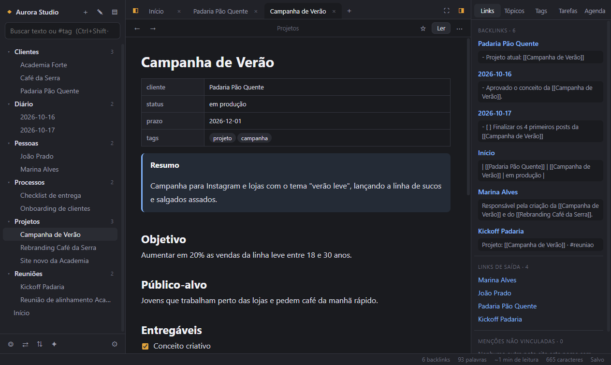
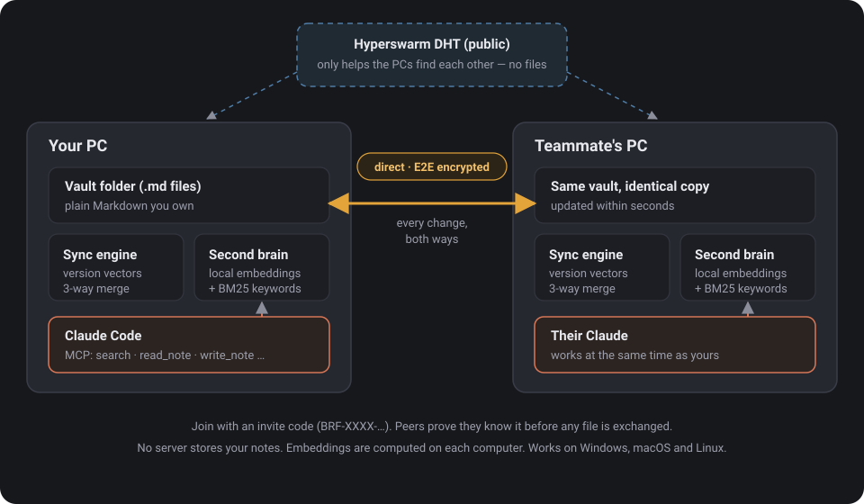
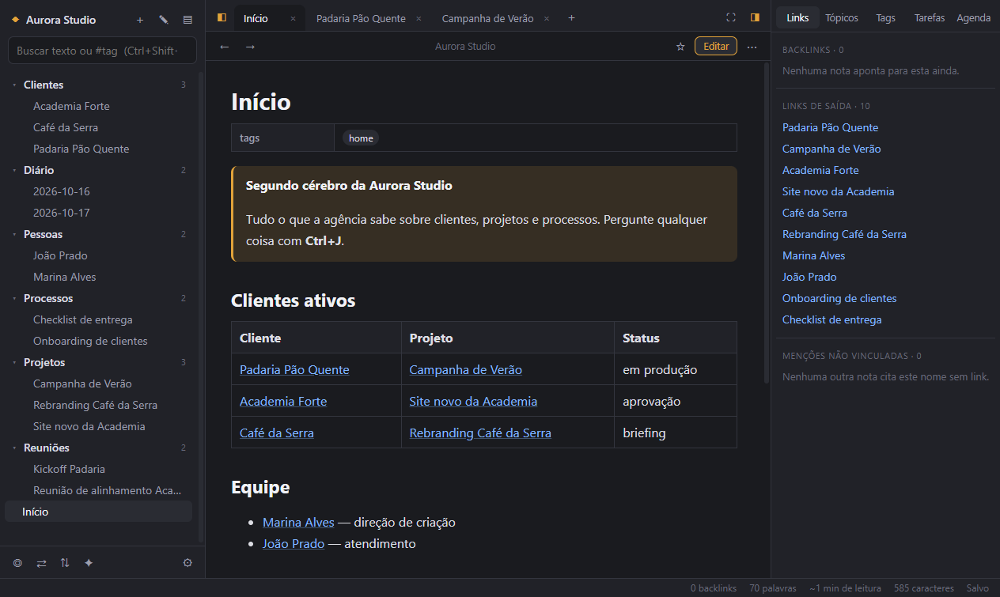
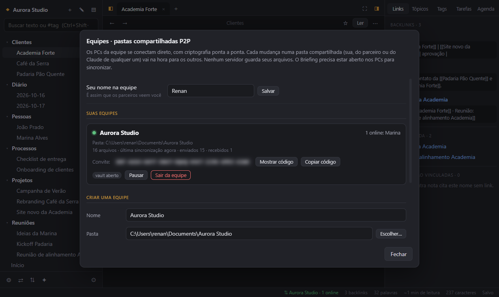
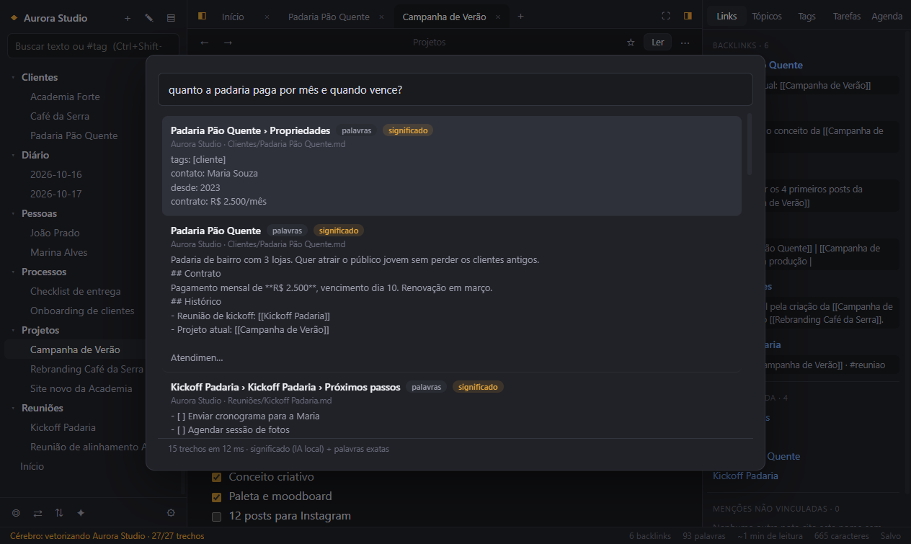
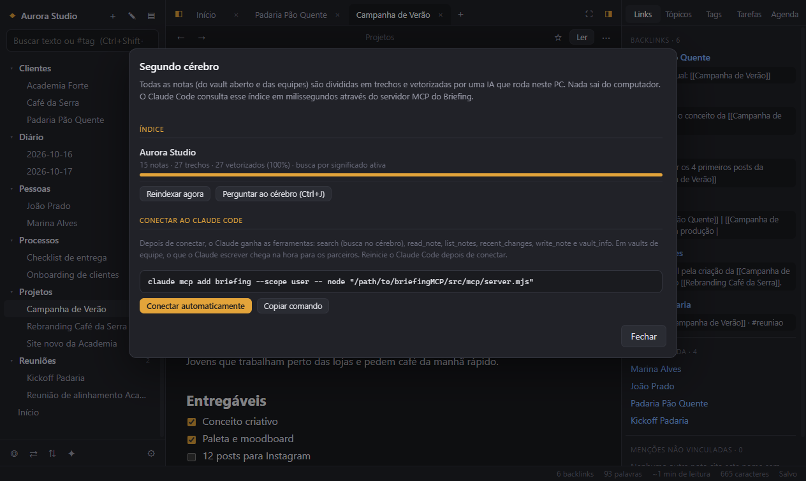
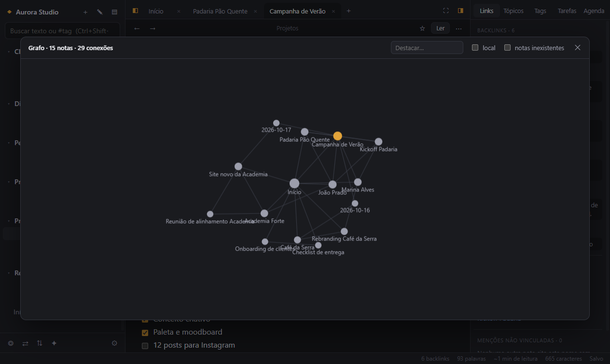
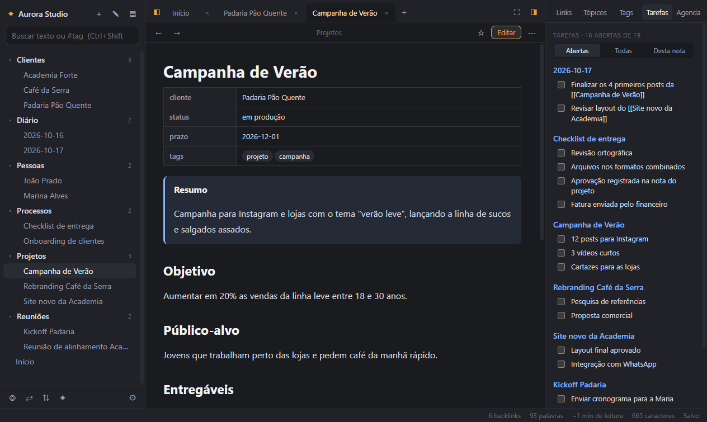

<div align="center">


# Briefing

**Otak kedua tim Anda — catatan Markdown lokal, dibagikan secara peer‑to‑peer, dan dapat dibaca oleh Claude.**

[](https://github.com/renankelm10/briefingMCP/actions/workflows/ci.yml)
[](../../LICENSE)


<!-- langs -->
[English](../../README.md) · [Português](README.pt-BR.md) · [Español](README.es.md) · [Français](README.fr.md) · [Deutsch](README.de.md) · [Italiano](README.it.md) · [Nederlands](README.nl.md) · [Polski](README.pl.md) · [Русский](README.ru.md) · [Українська](README.uk.md) · [Türkçe](README.tr.md) · [العربية](README.ar.md) · [हिन्दी](README.hi.md) · [简体中文](README.zh-CN.md) · [繁體中文](README.zh-TW.md) · [日本語](README.ja.md) · [한국어](README.ko.md) · **Bahasa Indonesia** · [Tiếng Việt](README.vi.md) · [ไทย](README.th.md)
<!-- /langs -->



</div>

---

## Apa itu Briefing?

Briefing adalah aplikasi catatan desktop untuk tim yang menginginkan **satu basis pengetahuan bersama tanpa layanan cloud di tengahnya**.

- 📝 **Tulis** dalam file Markdown biasa yang tersimpan di folder biasa di komputer Anda ("vault" Anda).
- 🔄 **Bagikan** folder dengan tim: setiap komputer menyimpan salinan yang identik, dan perubahan mengalir **langsung dari komputer ke komputer**, terenkripsi end‑to‑end, dalam hitungan detik.
- 🧠 **Tanyakan** apa saja: setiap catatan diindeks oleh model AI yang berjalan **di mesin Anda sendiri**, dan **Claude** (atau klien MCP mana pun) dapat mencari, membaca, dan menulis catatan Anda melalui server MCP bawaan.

Hasilnya: Anda dan rekan kerja dapat bekerja bersamaan, masing-masing dengan Claude sendiri, atas pengetahuan perusahaan yang sama, dan selalu melihat versi terbaru.

> Antarmuka saat ini berbahasa **Portugis Brasil**. Terjemahan sangat diterima — lihat [Berkontribusi](../../CONTRIBUTING.md).

## Cara kerjanya

<div align="center"></div>

1. **Anda membuat tim** dan memilih folder. Briefing membuat kode undangan seperti `BRF-7Q2M-…`.
2. **Rekan Anda menempelkan kode.** Kedua komputer saling menemukan melalui DHT publik [Hyperswarm](https://github.com/holepunchto/hyperswarm) — yang dipakai *hanya* untuk penemuan — lalu membuka koneksi langsung yang dienkripsi dengan Noise. Masing-masing pihak membuktikan bahwa ia mengetahui kode sebelum satu file pun dipertukarkan.
3. **Setiap perubahan langsung dikirim**, baik yang Anda tulis, rekan Anda, atau sebuah Claude. Suntingan bersamaan digabungkan baris demi baris (seperti Git); jika dua orang mengubah baris yang sama, versi lainnya disimpan sebagai *salinan konflik* yang identik di setiap komputer — tidak ada yang hilang.
4. **Setiap komputer mengindeks catatan secara lokal** (embedding multibahasa + pencarian kata kunci). Claude menanyai indeks melalui MCP dan mendapatkan bagian paling relevan dalam hitungan milidetik.

## Fitur

<table>
<tr>
<td width="50%"></td>
<td width="50%"></td>
</tr>
<tr>
<td><b>Menulis.</b> Editor dengan pratinjau langsung, <code>[[tautan]]</code> dengan pelengkapan otomatis, backlink, tag, callout, tugas, tabel, sematan, properti, tempel gambar, templat, catatan harian.</td>
<td><b>Folder tim.</b> Buat tim, bagikan kodenya, dan folder tetap identik di setiap komputer. Status online langsung, penggabungan, salinan konflik, riwayat.</td>
</tr>
<tr>
<td></td>
<td></td>
</tr>
<tr>
<td><b>Otak kedua.</b> <kbd>Ctrl</kbd>+<kbd>J</kbd> untuk bertanya dengan bahasa sehari-hari. Pencarian hibrida (makna + kata persis), sepenuhnya offline setelah unduhan model pertama.</td>
<td><b>Claude melalui MCP.</b> Satu klik mendaftarkan server MCP di Claude Code. Claude mendapatkan <code>search</code>, <code>read_note</code>, <code>write_note</code>, dan lainnya.</td>
</tr>
<tr>
<td></td>
<td></td>
</tr>
<tr>
<td><b>Graf.</b> Lihat bagaimana catatan saling terhubung; graf lokal, filter, seret, dan perbesar.</td>
<td><b>Tugas & agenda.</b> Semua <code>- [ ]</code> di vault dalam satu panel, ditambah kalender catatan harian.</td>
</tr>
</table>

<details>
<summary><b>Daftar fitur lengkap</b></summary>

- Tab (dipulihkan saat dibuka ulang), pengalih cepat, palet perintah, pencarian teks lengkap dan `#tag`
- Pratinjau langsung: sintaks Markdown tersembunyi di luar baris yang sedang disunting; tabel, callout, gambar, dan kotak centang langsung ditampilkan
- Pratinjau saat kursor di atas tautan, sebutan yang belum ditautkan bisa ditautkan dengan satu klik
- Mengganti nama atau memindahkan catatan memperbarui semua tautan ke catatan itu
- Templat dengan variabel (`{{title}}`, `{{date:DD/MM/YYYY}}`, `{{time}}`) dan templat **brief proyek** siap pakai
- Riwayat versi per catatan yang bisa dipulihkan; yang dihapus masuk ke tempat sampah sistem
- Ekspor catatan ke PDF
- Tema terang / gelap / sistem, warna aksen, ukuran huruf, lebar baris, panel yang dapat diubah ukurannya, mode fokus
- Bekerja dengan folder Markdown yang sudah ada (termasuk vault Obsidian)

</details>

## Instalasi

Unduh versi terbaru untuk sistem Anda dari **[Releases](https://github.com/renankelm10/briefingMCP/releases)**.

| Sistem | Berkas | Catatan |
|---|---|---|
| Windows 10/11 | `Briefing Setup x.y.z.exe` | Belum ditandatangani: pada peringatan SmartScreen klik **Info selengkapnya → Tetap jalankan**. |
| macOS 12+ (Apple Silicon) | `Briefing-x.y.z-arm64.dmg` | Belum dinotarisasi: klik kanan aplikasi → **Buka**, atau jalankan `xattr -dr com.apple.quarantine /Applications/Briefing.app`. Mac Intel: bangun dari kode sumber. |
| Linux (x64) | `Briefing-x.y.z.AppImage` / `.deb` | AppImage: `chmod +x Briefing-*.AppImage`. Di Ubuntu 24.04+ sebaiknya gunakan `.deb` (`sudo apt install ./briefing_*.deb`), yang mengatur sandbox Chromium. |

Saat pertama kali dibuka, Briefing membuat vault contoh di `Dokumen/Briefing`. Gunakan **Arquivo → Abrir outro vault…** untuk membuka folder apa pun.

### Membangun dari kode sumber

Membutuhkan [Node.js 22+](https://nodejs.org).

```bash
git clone https://github.com/renankelm10/briefingMCP.git
cd briefingMCP
npm install
npm start            # menjalankan aplikasi
npm run dist         # membuat installer untuk sistem Anda (di release/)
```

## Folder tim dalam 3 langkah

1. Buka folder yang ingin dibagikan sebagai vault, lalu tekan <kbd>Ctrl</kbd>+<kbd>Shift</kbd>+<kbd>E</kbd> (**Equipes**).
2. **Criar equipe** → kode undangan tersalin. Kirimkan ke rekan Anda melalui saluran pribadi.
3. Rekan Anda membuka **Equipes → Entrar numa equipe**, menempelkan kode, dan memilih folder kosong. File akan tiba begitu kedua komputer online.

Briefing harus berjalan di kedua komputer agar sinkronisasi terjadi. Siapa pun yang memiliki kode menjadi anggota penuh — perlakukan seperti kata sandi.

## Menghubungkan Claude (MCP)

Buka **✦ Segundo cérebro → Conectar automaticamente**, atau jalankan:

```bash
claude mcp add briefing --scope user -- node "/path/to/briefingMCP/src/mcp/server.mjs"
```

Mulai ulang Claude Code. Server menyediakan vault yang terbuka dan semua folder tim:

| Alat | Fungsinya |
|---|---|
| `search` | Pencarian hibrida semantik + kata kunci; mengembalikan bagian paling relevan beserta berkas dan barisnya |
| `read_note` | Isi lengkap sebuah catatan (melalui path atau cukup nama) |
| `list_notes` | Catatan dalam vault atau folder, beserta waktu perubahannya |
| `recent_changes` | Catatan yang baru diubah — termasuk perubahan dari rekan tim |
| `write_note` | Membuat, menimpa, atau menambahkan ke catatan (langsung tersinkron ke tim) |
| `vault_info` | Daftar vault, jumlah catatan/bagian yang diindeks, status pencarian semantik |

Klien MCP mana pun yang mendukung server stdio bekerja dengan cara yang sama. Gunakan `BRIEFING_VAULTS="/a;/b"` untuk memilih vault secara eksplisit.

## Keamanan & privasi

- Tanpa akun, tanpa server, tanpa telemetri. Catatan adalah file biasa di disk Anda.
- Koneksi sinkronisasi terenkripsi end‑to‑end dan diautentikasi dengan kode undangan; file dari jaringan tidak pernah ditulis di luar folder bersama, dan Briefing tidak pernah membuka file eksekusi yang diterima dari orang lain.
- Embedding dihitung secara lokal; model (`multilingual-e5-small`, ~120 MB) diunduh sekali dari Hugging Face.
- Respons MCP menandai isi catatan sebagai data yang tidak tepercaya untuk mengurangi risiko prompt injection.

Baca model ancaman lengkap di **[SECURITY.md](../../SECURITY.md)**. Laporkan kerentanan secara pribadi.

## Pintasan keyboard

| Pintasan | Aksi | Pintasan | Aksi |
|---|---|---|---|
| <kbd>Ctrl</kbd>+<kbd>O</kbd> | Pengalih cepat | <kbd>Ctrl</kbd>+<kbd>J</kbd> | Bertanya ke otak kedua |
| <kbd>Ctrl</kbd>+<kbd>P</kbd> | Palet perintah | <kbd>Ctrl</kbd>+<kbd>Shift</kbd>+<kbd>E</kbd> | Folder tim |
| <kbd>Ctrl</kbd>+<kbd>N</kbd> | Catatan baru | <kbd>Ctrl</kbd>+<kbd>Shift</kbd>+<kbd>B</kbd> | Brief proyek baru |
| <kbd>Ctrl</kbd>+<kbd>E</kbd> | Baca / sunting | <kbd>Ctrl</kbd>+<kbd>G</kbd> | Graf |
| <kbd>Ctrl</kbd>+<kbd>T</kbd> / <kbd>W</kbd> | Tab baru / tutup tab | <kbd>Ctrl</kbd>+<kbd>Shift</kbd>+<kbd>D</kbd> | Catatan harian |

Di macOS gunakan <kbd>⌘</kbd> sebagai ganti <kbd>Ctrl</kbd>.

## Tanya jawab

**Apakah ini Obsidian?** Bukan. Briefing adalah proyek sumber terbuka independen yang ditulis dari nol. Briefing kompatibel dengan folder Markdown biasa sehingga Anda bisa membuka vault yang sudah ada, tetapi tidak berafiliasi dengan atau didukung oleh Obsidian.

**Apakah butuh internet?** Hanya untuk menemukan rekan tim (DHT) dan mengunduh model AI satu kali. Catatan, pencarian, dan akses Claude bekerja secara offline.

**Bagaimana jika dua orang menyunting catatan yang sama?** Bagian yang berbeda digabungkan secara otomatis. Jika baris yang sama berubah, kedua versi disimpan: satu di catatan, satu lagi di salinan `(conflito de …)` di sebelahnya.

**Di mana data saya?** Di folder vault Anda (berkas `.md`). Data milik Briefing sendiri ada di `<vault>/.briefing/` (indeks, riwayat) dan di folder konfigurasi pengguna (`%APPDATA%\Briefing`, `~/Library/Application Support/Briefing`, `~/.config/Briefing`).

## Peta jalan

- Terjemahan antarmuka (i18n)
- Aplikasi pendamping seluler
- Relay opsional untuk jaringan yang memblokir koneksi langsung
- Izin per anggota dan rotasi kunci tim
- Installer yang ditandatangani dan dinotarisasi

## Berkontribusi

Issue dan pull request sangat diterima. Lihat **[CONTRIBUTING.md](../../CONTRIBUTING.md)** untuk penyiapan, pengujian, dan struktur proyek.

## Lisensi

[MIT](../../LICENSE) © 2026 Renan Kelm
